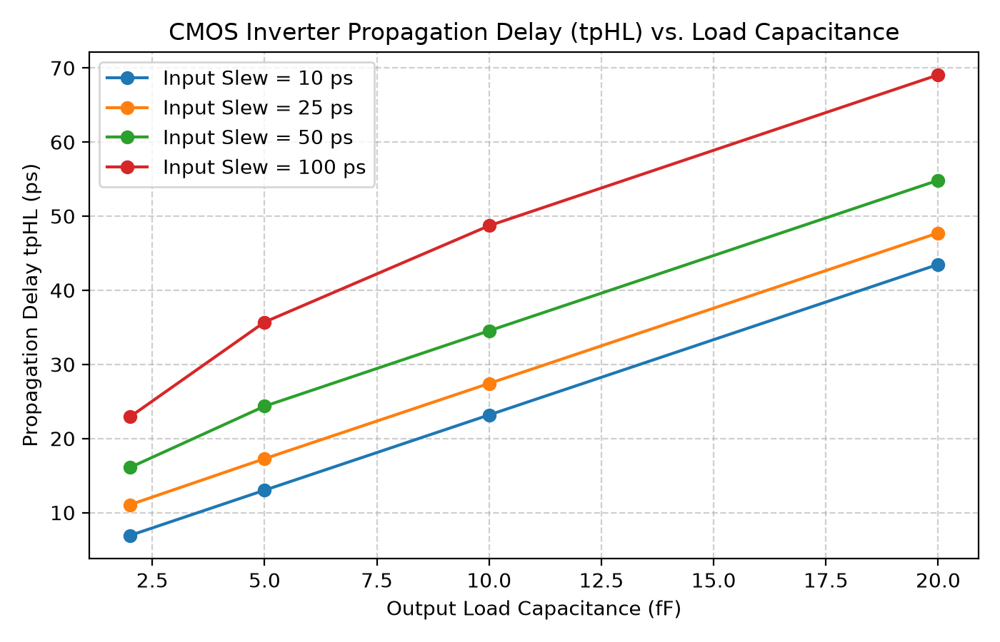

# CMOS Inverter Standard Cell Characterization

Automated SPICE characterization flow that sweeps input transition slew and output load capacitance on a CMOS inverter (`INV_X1`) to extract propagation delays ($t_{pHL}$, $t_{pLH}$) and generate a Liberty (`.lib`) Non-Linear Delay Model (NLDM) lookup table.

## Characterization Results



## Repository Structure
- `inverter.sp` — Parameterized SPICE netlist with `.meas` commands for 50% $V_{DD}$ propagation delay and 20%–80% transition slew.
- `char_flow.py` — Python automation script that runs batch `ngspice` sweeps across a 4×4 slew/load grid, parses simulation logs, exports `inv_x1.lib`, and plots delay curves.
- `inv_x1.lib` — Generated Liberty NLDM lookup table (`cell_fall`).
- `delay_vs_load.png` — Propagation delay ($t_{pHL}$) vs. capacitive load ($C_{load}$) plot.

## How to Run
1. Install dependencies:
   ```bash
   pip install numpy matplotlib